<picture><source media="(prefers-color-scheme: dark)" srcset="./assets/hero-dark.svg" /></picture>

  <a href="https://www.brandbakery.tech"><picture><source media="(prefers-color-scheme: dark)" srcset="./assets/link-brandbakery-dark.svg" /></picture></a>
  <a href="https://brivi.app"><picture><source media="(prefers-color-scheme: dark)" srcset="./assets/link-brivi-dark.svg" /></picture></a>
  <a href="https://www.linkedin.com/in/abhishek-kumar7/"><picture><source media="(prefers-color-scheme: dark)" srcset="./assets/link-linkedin-dark.svg" /></picture></a>
  <a href="https://x.com/AbhisheKumarA7"><picture><source media="(prefers-color-scheme: dark)" srcset="./assets/link-x-dark.svg" /></picture></a>

<picture><source media="(prefers-color-scheme: dark)" srcset="./assets/work-dark.svg" /></picture>

<a href="https://brivi.app"><picture><source media="(prefers-color-scheme: dark)" srcset="./assets/work-brivi-dark.svg" /></picture></a>
<a href="https://www.brandbakery.tech"><picture><source media="(prefers-color-scheme: dark)" srcset="./assets/work-brand-bakery-dark.svg" /></picture></a>
<picture><source media="(prefers-color-scheme: dark)" srcset="./assets/work-ombudy-dark.svg" /></picture>
<picture><source media="(prefers-color-scheme: dark)" srcset="./assets/work-bitesquare-dark.svg" /></picture>
<picture><source media="(prefers-color-scheme: dark)" srcset="./assets/work-mcpbouncer-dark.svg" /></picture>
<a href="https://github.com/abhishek207/ember"><picture><source media="(prefers-color-scheme: dark)" srcset="./assets/work-ember-dark.svg" /></picture></a>

<picture><source media="(prefers-color-scheme: dark)" srcset="./assets/clients-dark.svg" /></picture>
