  
  
  

## What I'm building

I founded **[Brand Bakery](https://www.brandbakery.tech)**, a design-first digital agency registered in India as an MSME. We design brands, build websites and stores, and now build AI employees for businesses. Most of my GitHub is private client and product work, so the charts below are drawn from those repos.

| | Project | What it is |
|:-:|---|---|
| 🍞 | **Brand Bakery** | The agency site, being rebuilt in Next.js with all of its motion intact. |
| 🧭 | **Brand Bakery Hub** | Our internal ops app: CRM, clients, AI agents, runs and reviews. Next.js on Cloudflare Workers with D1. |
| 🎨 | **BB Studio** | The design tool we use in live client sessions. |
| 🤖 | **AI Employees** | Custom AI staff for businesses that handle calls, WhatsApp, email and follow-ups. We build, deploy and train them. |
| ⚖️ | **Arzi** | Helps Indian consumers draft and send a formal complaint to a company. |
| 🧠 | **Kosh** | A native macOS app that turns what's on screen into a private, searchable memory, on device only. Swift. |
| 🍜 | **BiteSquare** | A cloud-kitchen storefront and owner app on Cloudflare Workers, Neon Postgres and R2. |
| 🛡️ | **MCPBouncer** | A directory of MCP servers with deterministic 0 to 100 safety scores. |
| 🔥 | **[Ember](https://github.com/abhishek207/ember)** | A calm companion for quitting smoking. |
| ✨ | **Brivi** | An AI workspace across web, browser extension and desktop. Ten repos and counting. |

**Client builds:** storefronts, sites and launches for brands like Pure Prakriti, Mino Bowls (Shopify Hydrogen), AccelHire, Social Road and Richa Jha.

## By the numbers

  
  

## Open source

| Repo | |
|---|---|
| [**nextbase**](https://github.com/abhishek207/nextbase) | A lean, production-shaped Next.js 16 SaaS starter. Beginner friendly and ready for coding agents. |
| [**sarvam-skill**](https://github.com/abhishek207/sarvam-skill) | A Sarvam AI skill for coding agents: Indian-language TTS, STT, translation and voice agents. |
| [**ember**](https://github.com/abhishek207/ember) | A quiet app for quitting smoking. |

## Stack

  

Next.js, React and Tailwind with Motion for the front end. Cloudflare Workers, D1 and R2 for most backends. Supabase and Neon when I need Postgres. Shopify Hydrogen for commerce. Swift for native Mac. Sarvam for Indian-language voice.

## Contributions

<picture>
  <source media="(prefers-color-scheme: dark)" srcset="https://raw.githubusercontent.com/abhishek207/abhishek207/output/snake-dark.svg" />
  
</picture>

## Work with us

Need a brand, a website that moves, or an AI employee that picks up the phone? Write to us through **[brandbakery.tech](https://www.brandbakery.tech)**.

Charts are generated by [`scripts/build_cards.py`](scripts/build_cards.py) from [`scripts/data.json`](scripts/data.json). Last updated 20 Oct 2026.
